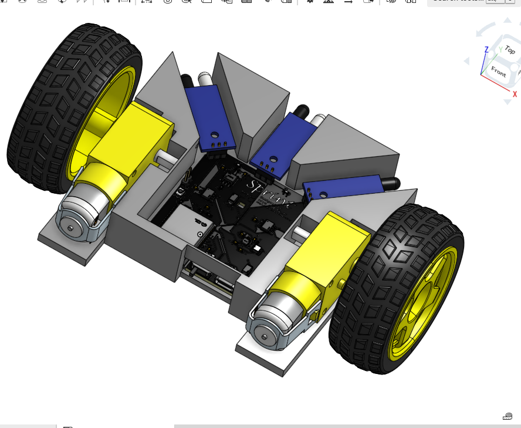
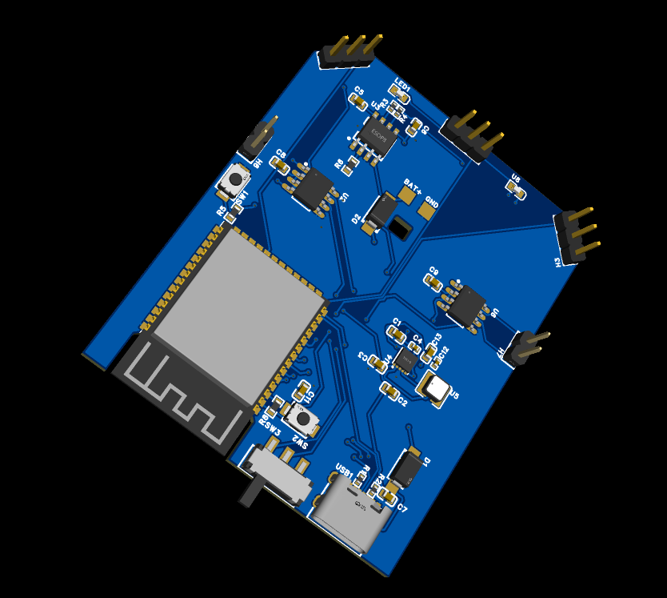

# Sprint: A RC car powered by the ESP32-S3 featuring autonomous driving capabilities and an ESP-NOW remote designed to be controlled with one hand!

Sprint is a smart, ESP32-powered, RC car that features self-driving capabilities through a simple push of a button on the side of the remote! Both the remote and the mainboard have a powerful ESP32-S3 chip powering them with 8MB of flash and 2MB of PSRAM! The mainboard features dual motors with each being powered by a L9110S motor driver. It also features three obstacle avoidance sensors for self-driving! The remote features a SSD1306 OLED display, a joystick, and a mode switch! The remote is designed to effortlessly navigate the robot manually with one hand. And to activate self-driving mode, simply press the button located on the side, near the power switch, to switch between modes!

### ELON MUSK'S FLYING CAR GOT NOTHING ON US!

# Schematics:

# PCBs:

# Key Features:
|Features|Model|
|-|-|
|Processor|ESP32-S3-WROOM-1-N8R2|
|Power Supply|Lipo Battery, chargeable by USB-C through a battery charger|
|Communication/Data Transfer|LoRa|
|LDO|TPS63031DSKR buck boost|
|Battery Charger|TP4056|
|Motors|TT Motors|
|Motor Drivers|L9110S|
|USB-C Port|MC-403L68-Z10|
|Obstacle sensors||

### We used AI tools for researching to: cross-check our schematics, understand technical details and research in general!
