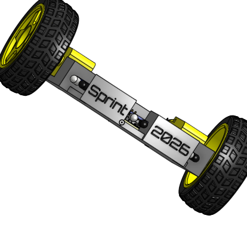
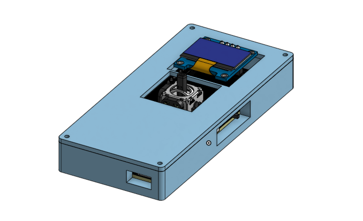

# Sprint: An RC messenger car powered by the ESP32-S3 and featuring a LORA remote control!

### ELON MUSK'S FLYING CAR GOT NOTHING ON US!

# Key Features:
|Features|Model|
|-|-|
|Processor|ESP32-S3-WROOM-1-N8R2|
|Power Supply|Lipo Battery, chargeable by USB-C through a battery charger|
|Communication/Data Transfer|LoRa|
|LDO|TPS63031DSKR buck boost|
|Battery Charger|TP4056|
|Motors|N20|
|Motor Drivers|L9110S|
|USB-C Port|MC-403L68-Z10|
|Obstacle sensors||

