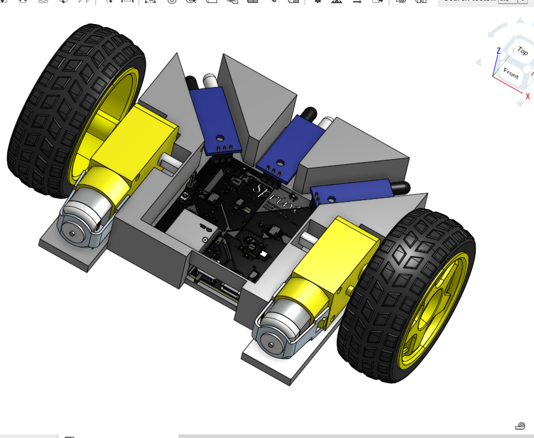
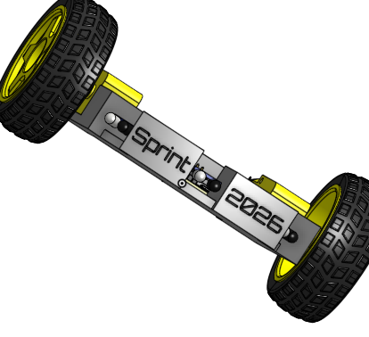
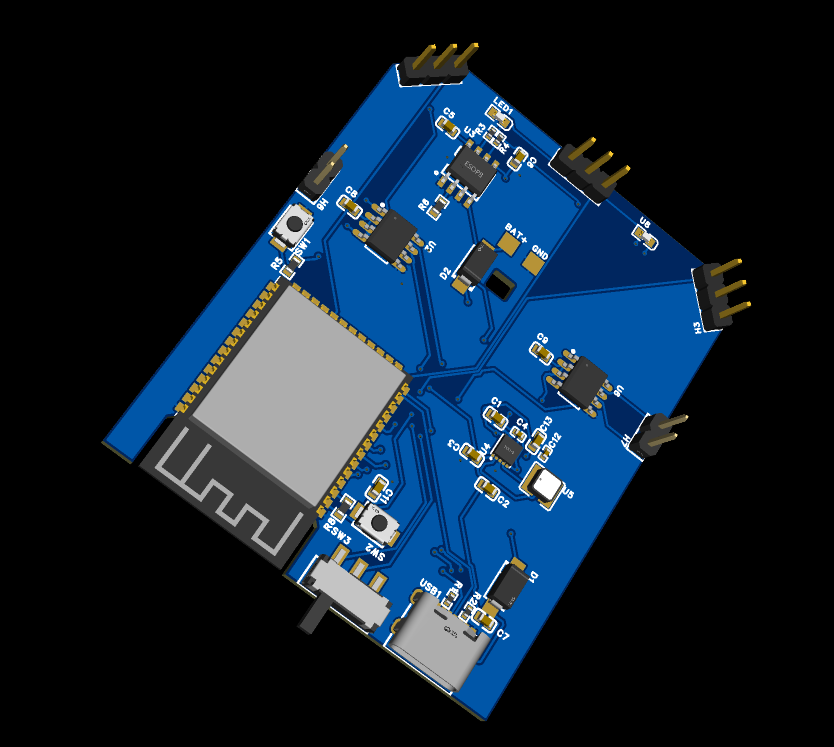

# Sprint: A RC car powered by the ESP32-S3 featuring autonomous driving capabilities and an ESP-NOW remote designed to be controlled with one hand!

Sprint is a smart, ESP32-powered, RC car that features self-driving capabilities through a simple push of a button on the side of the remote! Both the remote and the mainboard have a powerful ESP32-S3 chip powering them with 8MB of flash and 2MB of PSRAM! The mainboard features dual motors with each being powered by a L9110S motor driver. It also features three obstacle avoidance sensors for self-driving! The remote features a SSD1306 OLED display, a joystick, and a mode switch! The remote is designed to effortlessly navigate the robot manually with one hand. And to activate self-driving mode, simply press the button located on the side, near the power switch, to switch between modes!

### ELON MUSK'S FLYING CAR GOT NOTHING ON US!

# Schematics:

# PCBs:

# Key Features:
|Features|Model|
|-|-|
|Processor|ESP32-S3-WROOM-1-N8R2|
|Power Supply|Lipo Battery, chargeable by USB-C through a battery charger|
|Communication/Data Transfer|ESP-NOW|
|LDO|TPS63031DSKR buck boost|
|Battery Charger|TP4056|
|Motors|TT Motors|
|Motor Drivers|L9110S|
|USB-C Port|MC-403L68-Z10|
|Obstacle Sensors|IR Obstacle Avoidance Modules|

## How to flash!

- plug your board using a usb-c cable
- hold the boot button down, press and release the reset button (whilc holding boot), then release boot!
- in arduino -> tools -> board -> esp32 -> esp32s3 dev module
- from usb-mode, select Hardware CDC and JTAG
- then enable usb cdc on boot
- click upload code (Arduino)
Do this for both the remote and the mainboard!

## Combined BOM (Mainboard + Remote)

Prices shown are the BOM unit prices from the LCSC/JLCPCB export in the repo. Blank values mean the source BOM did not populate a price or distributor part record.

| No. | Quantity | Comment | Designator | Footprint | Value | Manufacturer Part | Manufacturer | Supplier Part | Supplier | LCSC Price | JLCPCB Price/Other Source Price | Link |
|---|---|---|---|---|---|---|---|---|---|---|---|---|
| 1 | 4 | Test-Point | BAT+,GND,BAT+,GND | Test-Point-0.5mm |  |  |  |  |  | 1.9867 |  |  |
| 2 | 12 | 10uF | C1,C2,C3,C5,C6,C8,C9,C1,C2,C3,C5,C6 | C0603 | 10uF | TCC0603X7R106M6R3CT | CCTC(三环) | C53032292 | LCSC |  | 0.0052 | https://www.lcsc.com/product-detail/C53032292.html |
| 3 | 2 | 100nF | C4,C4 | C0402 | 100nF | CGA0402X7R104K6R3GT | HRE(芯声) | C22435938 | LCSC |  | 0.0005 | https://www.lcsc.com/product-detail/C22435938.html |
| 4 | 2 | 10uF | C7,C10 | C0603 | 10uF | CC0603MRX5R7BB106 | YAGEO(国巨) | C109457 | LCSC |  | 0.0422 | https://www.lcsc.com/product-detail/C109457.html |
| 5 | 4 | 1uF | C11,C13,C7,C9 | C0603 | 1uF | TCC0603X5R105K160CT | CCTC(三环) | C696901 | LCSC |  | 0.0011 | https://www.lcsc.com/product-detail/C696901.html |
| 6 | 2 | 100nF | C12,C8 | C0402 | 100nF | CL05B104KO5NNNC | SAMSUNG(三星) | C1525 | LCSC |  | 0.0008 | https://www.lcsc.com/product-detail/C1525.html |
| 7 | 2 | 100nF | C14,C11 | C0603 | 100nF | CC0603KRX7R9BB104 | YAGEO(国巨) | C14663 | LCSC |  | 0.0017 | https://www.lcsc.com/product-detail/C14663.html |
| 8 | 4 | SS14 | D1,D2,D1,D2 | SMA_L4.3-W2.6-LS5.0-RD |  | SS14 | YONGYUTAI(永裕泰) | C47147601 | LCSC |  | 0.0017 | https://www.lcsc.com/product-detail/C47147601.html |
| 9 | 3 | 2.54-1*3P针 | H1,H2,H3 | HDR-TH_3P-P2.54-V-M-1 |  | 2.54-1*3P针 | BOOMELE(博穆精密) | C49257 | LCSC |  | 0.0043 | https://www.lcsc.com/product-detail/C49257.html |
| 10 | 2 | PH2.54-1X2P-H25 | H6,H7 | HDR-TH_2P-P2.54-V-M-4 |  | PH2.54-1X2P-H25 | JXTCONN(聚兴泰) | C42431798 | LCSC |  | 0.0025 | https://www.lcsc.com/product-detail/C42431798.html |
| 11 | 2 | YLED0603R | LED1,LED1 | LED0603-FD |  | YLED0603R | YONGYUTAI(永裕泰) | C19171390 | LCSC |  | 0.001 | https://www.lcsc.com/product-detail/C19171390.html |
| 12 | 4 | 5.1kΩ | R1,R2,R1,R2 | R0402 | 5.1kΩ | FRC0402J512 TS | FOJAN(富捷) | C2906948 | LCSC |  | 0.0003 | https://www.lcsc.com/product-detail/C2906948.html |
| 13 | 4 | 1kΩ | R3,R4,R5,R7 | R0402 | 1kΩ | FRC0402J102 TS | FOJAN(富捷) | C2906899 | LCSC |  | 0.0002 | https://www.lcsc.com/product-detail/C2906899.html |
| 14 | 4 | 10kΩ | R5,R8,R8,R9 | R0603 | 10kΩ | RC0603FR-0710KL | YAGEO(国巨) | C98220 | LCSC |  | 0.0006 | https://www.lcsc.com/product-detail/C98220.html |
| 15 | 2 | 1.2kΩ | R6,R6 | R0603 | 1.2kΩ | 0603WAF1201T5E | UNI-ROYAL(厚声) | C22765 | LCSC |  | 0.0006 | https://www.lcsc.com/product-detail/C22765.html |
| 16 | 2 | 1MΩ | R7,R12 | R0603 | 1MΩ | AC0603FR-071ML | YAGEO(国巨) | C116678 | LCSC |  | 0.0009 | https://www.lcsc.com/product-detail/C116678.html |
| 17 | 2 | 470kΩ | R11,R13 | R0603 | 470kΩ | 0603WAF4703T5E | UNI-ROYAL(厚声) | C23178 | LCSC |  | 0.0005 | https://www.lcsc.com/product-detail/C23178.html |
| 18 | 4 | HX 3x4x2-2P-1.6N TACTILE SWITCH | SW1,SW2,SW2,SW3 | KEY-SMD_L4.0-W3.0-LS4.9-1 |  | HX 3x4x2-2P-1.6N TACTILE SWITCH | hanxia(韩下) | C49234124 | LCSC |  | 0.0038 | https://www.lcsc.com/product-detail/C49234124.html |
| 19 | 2 | MST-12D18G4 SPDT Slide Switch | SW3,SW4 | SW-SMD_MST-12D18G4-SPDT-SLIDE-SWITCH |  | MST-12D18G4 SPDT Slide Switch | SHOU HAN(首韩) | C49023767 | LCSC |  | 0.0126 | https://www.lcsc.com/product-detail/C49023767.html |
| 20 | 1 | 2.4GHz | U1 | WIRELM-SMD_ESP32-S3-WROOM-1 | 2.4GHz | ESP32-S3-WROOM-1-N8R2 | ESPRESSIF(乐鑫) | C2913204 | LCSC |  | 0.6995 | https://www.lcsc.com/product-detail/C2913204.html |
| 21 | 2 | L9110S | U2,U6 | SOP-8_L4.9-W3.9-P1.27-LS6.0-BL |  | L9110S | Mixic(中科芯亿达) | C513306 | LCSC |  | 0.0248 | https://www.lcsc.com/product-detail/C513306.html |
| 22 | 2 | TP4056 | U3,U3 | ESOP-8_L4.9-W3.9-P1.27-LS6.0-BL-EP |  | TP4056 | UMW(友台半导体) | C725790 | LCSC |  | 0.014 | https://www.lcsc.com/product-detail/C725790.html |
| 23 | 1 | TPS63031DSKR | U4 | SON-10_L2.5-W2.5-P0.50-TL-EP |  | TPS63031DSKR | TI(德州仪器) | C15516 | LCSC |  | 0.1554 | https://www.lcsc.com/product-detail/C15516.html |
| 24 | 2 | 1.5uH | U5,U5 | IND-SMD_L3.0-W3.0_LPS3015-222ML | 1.5uH | LPS3015-152MRC | Coilcraft(线艺) | C17382749 | LCSC |  | 0.1731 | https://www.lcsc.com/product-detail/C17382749.html |
| 25 | 2 | YLED0603G | U8,U8 | LED0603-FD |  | YLED0603G | YONGYUTAI(永裕泰) | C19273151 | LCSC |  | 0.001 | https://www.lcsc.com/product-detail/C19273151.html |
| 26 | 2 | MC-403L68-Z10 | USB1,USB1 | USB-TYPE-C-SMD_MC-403L68-Z10 |  | MC-403L68-Z10 | HANBO(汉博) | C47326496 | LCSC |  | 0.0089 | https://www.lcsc.com/product-detail/C47326496.html |
| 27 | 5 | PCB (BOM1) | - | - | - | - | JLCPCB | - | JLCPCB | - | $5.68 | https://jlcpcb.com/ |
| 28 | 2 | LiPo Battery 2000mAh | - | https://www.aliexpress.us/item/3256802733222186.html | - | - | - | - | AliExpress | - | $6.99 | https://www.aliexpress.us/item/3256802733222186.html |
| 29 | 1 Set | 4 Sets of TT motors and wheels | - | https://www.aliexpress.us/item/3256809725271346.html | - | - | - | - | AliExpress | - | $3.95 | https://www.aliexpress.us/item/3256809725271346.html |
| 30 | 5 Pack | IR Obstacle Avoidance Sensors | - | https://www.aliexpress.us/item/3256806612336696.html | - | - | - | - | AliExpress | - | $2.95 | https://www.aliexpress.us/item/3256806612336696.html |
| 31 | 1 | 2.54-1*4P母 | H1 | HDR-TH_4P-P2.54-V-F |  | 2.54-1*4P母 | BOOMELE(博穆精密) | C2718488 | LCSC |  | 0.0124 | https://www.lcsc.com/product-detail/C2718488.html |
| 32 | 4 | 4.7kΩ | R3,R4,R10,R11 | R0603 | 4.7kΩ | 0603WAF4701T5E | UNI-ROYAL(厚声) | C23162 | LCSC |  | 0.0005 | https://www.lcsc.com/product-detail/C23162.html |
| 33 | 1 | RKJXV1220001 | SW1 | SW-TH_RKJXV1220001 |  | RKJXV1220001 | ALPSALPINE(阿尔卑斯阿尔派) | C219778 | LCSC |  | 0.1142 | https://www.lcsc.com/product-detail/C219778.html |
| 34 | 1 | 2.4GHz | U1 | WIRELM-SMD_ESP32-S3-WROOM-1 | 2.4GHz | ESP32-S3-WROOM-1-N8R2 | ESPRESSIF(乐鑫) | C2913204 | LCSC |  | 0.6996 | https://www.lcsc.com/product-detail/C2913204.html |
| 35 | 1 | 2.54-1*8 | U2 | HDR-TH_8P-P2.54-V-M |  | 2.54-1*8 | ZHOURI(洲日) | C5156616 | LCSC |  | 0.0067 | https://www.lcsc.com/product-detail/C5156616.html |
| 36 | 1 | TPS63031DSKR | U4 | SON-10_L2.5-W2.5-P0.50-TL-EP |  | TPS63031DSKR | TI(德州仪器) | C15516 | LCSC |  | 0.1555 | https://www.lcsc.com/product-detail/C15516.html |
| 37 | 1 | YZA-059-8.0 | U6 | SW-TH_YZA-059-8.0 |  | YZA-059-8.0 | YIZHI(逸致) | C49108696 | LCSC |  |  |  |
| 38 | 5 | PCB (BOM2) | - | - | - | - | JLCPCB | - | JLCPCB | - | $5.68 | https://jlcpcb.com/ |
| 39 | 1 | MPU6050 Module | - | https://www.aliexpress.us/item/3256809871479525.html | - | - | - | - | AliExpress | - | $1.99 | https://www.aliexpress.us/item/3256809871479525.html |
| 40 | 1 Set | Set of M2 screws | - | https://www.aliexpress.us/item/2255799870438450.html | - | - | - | - | AliExpress | - | $2.90 | https://www.aliexpress.us/item/2255799870438450.html |
| 41 | 1 | SSD1306 128x64 OLED | - | https://www.aliexpress.us/item/3256805954920554.html | - | - | - | - | AliExpress | - | $2.49 | https://www.aliexpress.us/item/3256805954920554.html |
| 42 | 1 | 3D Prints |  |  |  |  |  |  | Printing Legion |  | $20 |  |
|  |  | TOTAL (priced items only) |  |  |  |  |  |  |  |  | $70.09 |  |

Total BOM cost (combined Mainboard + Remote, LCSC prices where available): $2.52 USD

### We used AI tools for researching to: cross-check our schematics, understand technical details and research in general!
