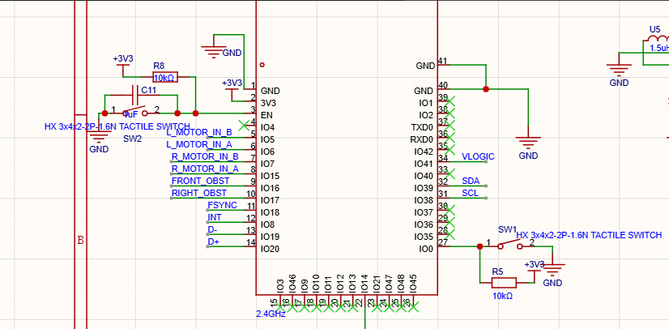
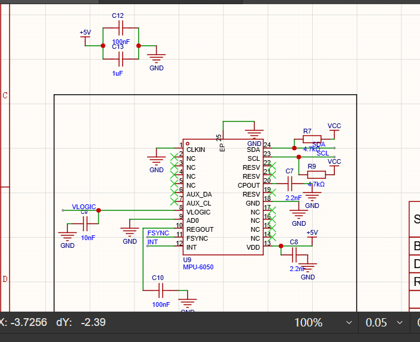
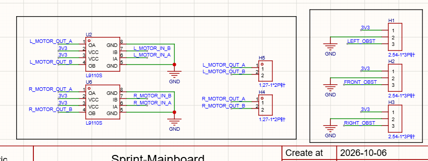
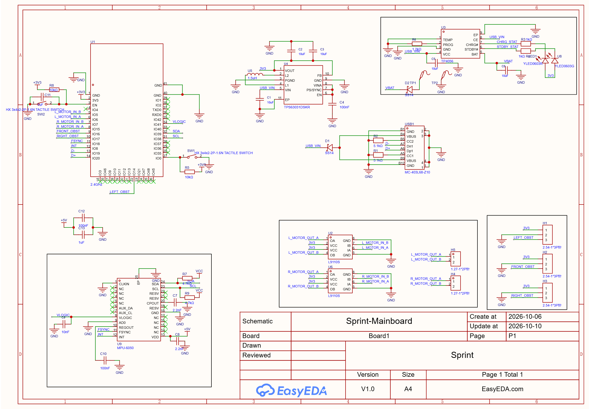
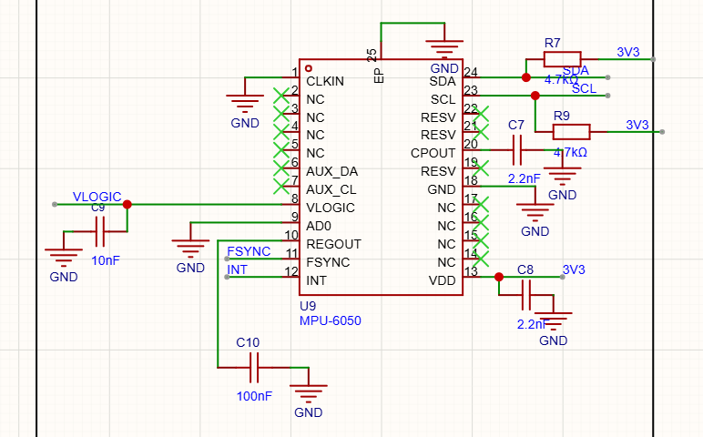
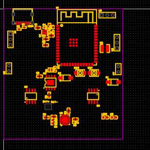

# 10/6/2026 Started this project + started with first schematic!! (Arya: 1hr 20mins)

Arya:
Today, we started with researching the parts that will be in our PCB for the RC car and also discussed what we should pick for our microcontroller. We decided to choose the ESP32-S3 since it supports USB-OTG and is way more powerful than the normal ESP32-Wroom. We are currently thinking about making the RC car as small as possible to make it special. And the ESP32-S3's USB-OTG compatibility will help that be smaller since there will be no need for a USB-to-Serial converter to program the chip. I also added a TP4056 for charging the battery and I also added a L9110S to the schematic since we will need a motor driver and that directly driving the motors from the ESP32 chip might not be good and might fry the chip which we do not want to happen. I also went and found a USB-C data port that had the least pins since we want to keep wiring simple.

Lapse: https://lapse.hackclub.com/timelapse/_cHRpcqyOjym

# 10/6/2026 Added buck-boost converted + wired it along with USB!! (Arya: 1hr)

Arya: Today, I did some more research on the things that will be needed for the PCB controller board of the actual RC car. I added a buck-boost converter to it and then finished wiring it along with the USB-C port! I was actually going to use an LDO, but I remembered that we used a buck-boost with our last project and I did not know the difference so I did some research with AI and learnt that a LDO only decreases the voltage while a buck-boost can both decrease and increase the voltage and I went with that because the battery is going to have fluctuating voltage based off the amount of charge left. I then read through some of its datasheet and then added parts. It needed a thing called an inductor, which I don't understand too much, but I also used some AI to help me understand that. I then looked through the list of the parts used on the example diagram on the datasheet and used the same model of the inductor from the datasheet. I also did wire the USB-C port today, there was nothing too interesting other than the fact that I had to do a 5.1k Ohm pull-down on both of the CC pins so that the port would receive power from a USB-C PD charger, which is a protocol that many chargers use now.  I also did add some decoupling capacitors to the buck-boost converter as well and could not find the exact model, but I did find a different brand that did have the exact same specifications, so I deciced to go with that. I should get plenty more of the wiring and other things done when I work on this next time!

Lapse: https://lapse.hackclub.com/timelapse/hKrlQN9dlEar

# 10/8/2026 Finished wiring the TP4056!! (Arya: 30 mins)

Arya: Today, I did not get too much work, but I did manage to finish the wiring of the TP4056, the battery charging module, on the schematic! I decided to just use the wiring from our previous project that used the same battery charger, and I swapped the original 10uF capacitors and replaced them with the 10uF capacitors from the buck-boost converter so that we would have one brand of capacitors for the same value which can make PCBA simpler. We were also talking about what else to do, and Funmi might add a gyroscope to the schematic for detecting the turning of the car. A example gyroscope, like the MPU-6050, only measures the velocity of the turning so we might have to put in code that calculates the direction of the car by reading the velocity form the gyroscope and doing calculations with it. I will try to get more work on this the next time that I work on this, and if I do not know what to do with the schematic for the RC car controller, I might just start working on the schematic for the ESP-NOW remote of the car!

Funmi: (Forgot to journal earlier after my two timelpases but gonna recap what I did) I searchef for and added a gyro sensor, a time of flight sensor, and a more powerful motor driver (drv8833) to change the one my teamate added! even though we're no longer using that! we're leaving it as l9110S!

Timelapse: https://lapse.hackclub.com/timelapse/tBGc42Y2XFks

# 10/9/2026 Almost fin schematic for mainboard + started with schematic for remote!! (Arya: 2hrs)

Arya: Today, we managed to almost complete the schematic for the mainboard module! The mainboard is what we are calling the board that will be on the actual RC car and control everything. We continued with everything on the PCB and we decided that we should make the car a "smart" car by also adding an autonomous feature to it. We decided to make the car autonomous by adding 3 obstacle avoidance sensors to it: one for the left, front, and right. These sensors should guide the cars and prevent it from crashing. We also added an MPU-6050 to the schematic. We also discussed on what we will do next to the mainboard, and we think that it is now almost fully done! We then started working on the remote-control schematic as well, though we did not get too much work done on it. I did copy some things over from the schematic for the mainboard, like the USB-C port and the buck-boost converter. I still have to do a bit more work on the schematic for the mainboard the next time that I work on this project, but it should then be done! And for the remote, I have also used the same ESP32-S3 from the mainboard's schematic and I also added some header pins for a SSD1306 OLED display.

Lapse: https://lapse.hackclub.com/timelapse/LVJRFMl_P4IT

Funmi: I wired the gyro sensor pins referencing the schematic and also wired some of the pins on the esp32 (i2c and connections to the gyro sensors)! I also added and wired header pins for the motors! We also started the remote control schematic! We're gonna put a small oled display (ssd1306) some joysticks, and it's gonna connect to the car using lora!

If my teammate didn't mention, it's now gonna be a MESSENGER CAR! So, like we don't have to see it to control it.. we can send it on an errand, like deliver this very tiny thing to someone (i don't mean it's robotics, it just moves around)

Timelapse: https://lapse.hackclub.com/timelapse/rE-SwynycOkj
https://lapse.hackclub.com/timelapse/FW4wM0PNGguM

# 10/10/2026 Finished schematic for mainboard + found parts for remote control schematic!! (Arya: 3 hrs)

Arya: Today, we managed to finish the schematic for the mainboard module! We started off with wiring some of the parts and then started wiring things to the GPIOs of the ESP32. I went and found a good source that gave the pinouts for the GPIO of the ESP32-S3, and I used that chart to connect the items to the best GPIOs available to ensure that it would not interfere with the normal function of the ESP32. I also did add another motor driver as well to the schematic since I realized that we also needed out motors to spin in reverse to go backwards. I then realized that the motor can only go in one direction one of the pins is connected to GND directly. So, I connected the positive and negative of the motors one of the two outputs in the motor driver so that it could drive one pin low and the other high (and also in the reverse order) to allow for our car to be able to move in the ways we intended it to. We used header pins to be able connect the motors to the mainboard. I then went to search for some joysticks to use on the remote-control module, as I could not find one that would match our intended expectations for it. I then did some more searching and a lot of looking and then found a decent joystick that met our requirements. We also decided to do a single-hand controller design instead of a game controller-like design so that we only need one joystick and a smaller PCB. Funmi will add decoupling capacitors to the schematic for general power stability, but other than that, we are completely (hopefully!) done with the schematic for the mainboard!

Lapse: https://lapse.hackclub.com/timelapse/jUbFVXi4biCB

Funmi: We finished up the car's main schematic! I finished up the wiring for the esp32.. wired the boot and enable pins and completed the gyro! I also added decoupling caps for the esp32! (all other ICs have theirs) and wired the motor pins to the esp32!

We're moving onto pcb for the car's mainboard, and to the schematic of the indoor module!!

Timelapse: https://lapse.hackclub.com/timelapse/Yt7Ejcd5DNHG

**11th October 2026**

I started placing the components for the outdoor module! My teammate said he wanted the car to be as small as possible but idk whatever! it's currently about 55mm x 60mm

I also fixed many issues in the schematic.. I realised I mistakenly added 1.27 mm header pins for the motors instead of 2.54 mm, so I changed that!! Also, cuz of how Arya and I added our power labels (3v3) differently (power symbols and net labels for 3v3), I had to change everything to be 3v3 net label

I finished placing all the components in reasonable places...and had to do some research for it (never dealt w motors before)I pleaced the headers fro the motors at the edges of the pcb. I also placed the obstacle sensors at their respective front, left and right.. close to the edges.. only thing is front ain't in the middle... idt that's an issue tho!

All for now! Gonna start wiring once I reboot m lapii!
Timelapse: https://lapse.hackclub.com/timelapse/naYPkAaK_N34

