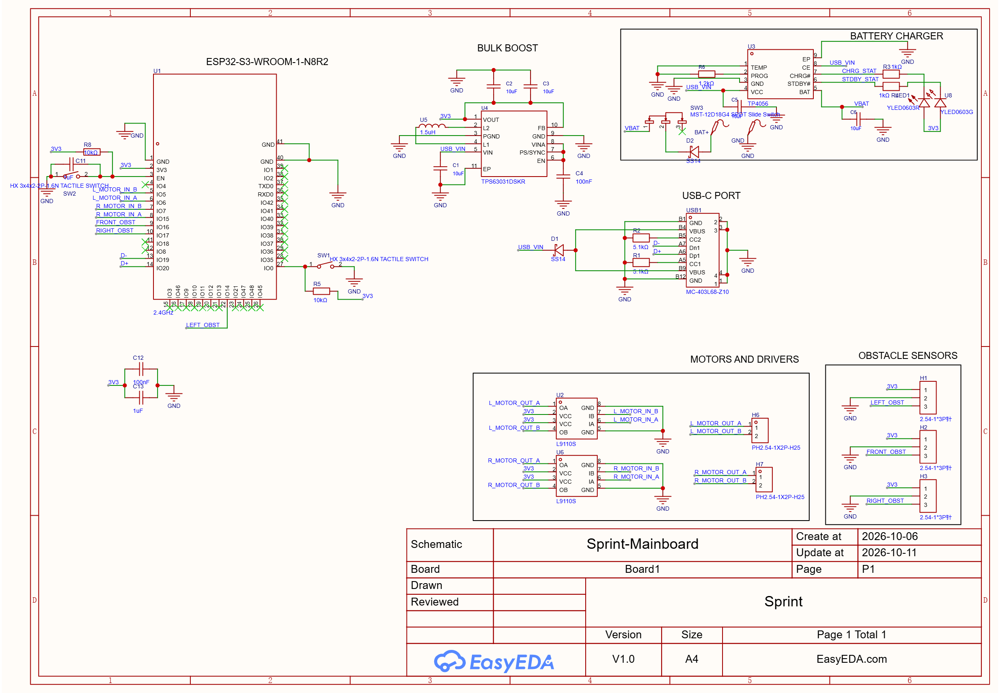
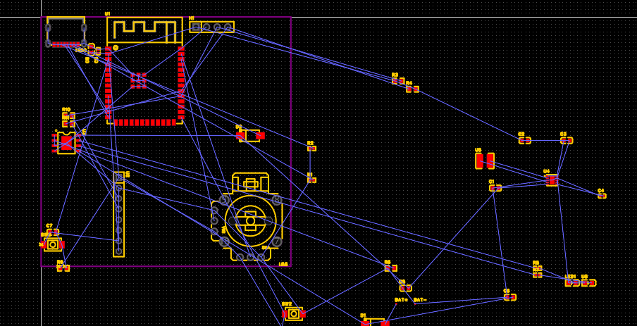
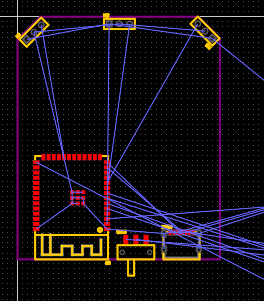
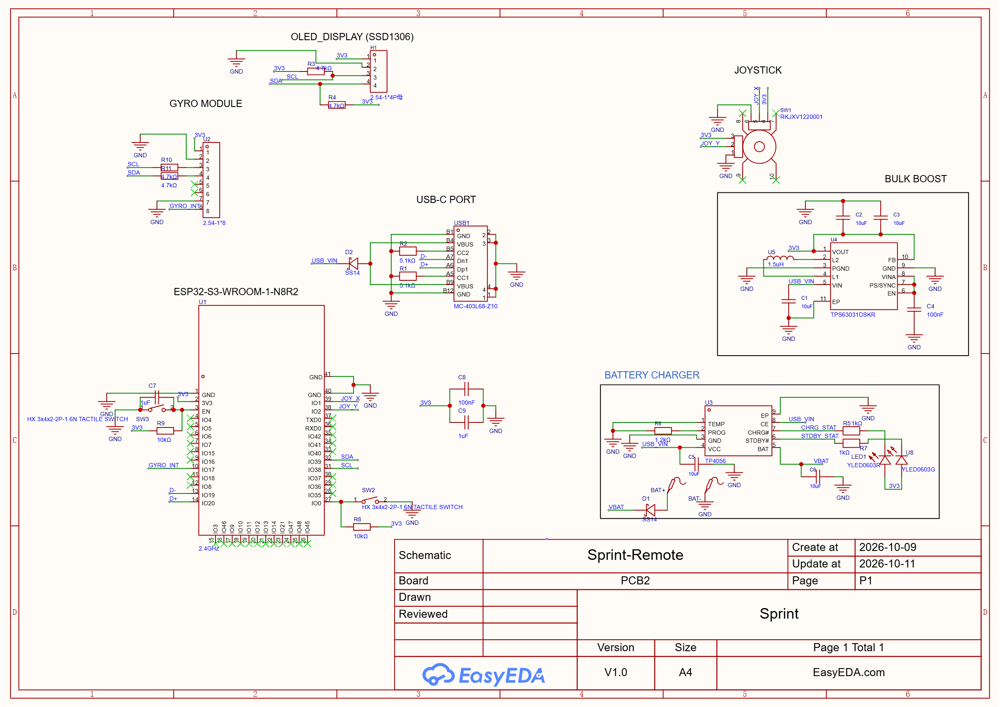
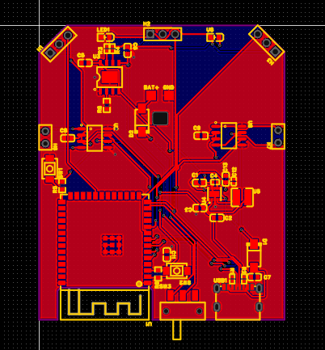

## 10/6/2026 Started this project + started with first schematic!! (Arya: 1hr 20mins)

Arya:
Today, we started with researching the parts that will be in our PCB for the RC car and also discussed what we should pick for our microcontroller. We decided to choose the ESP32-S3 since it supports USB-OTG and is way more powerful than the normal ESP32-Wroom. We are currently thinking about making the RC car as small as possible to make it special. And the ESP32-S3's USB-OTG compatibility will help that be smaller since there will be no need for a USB-to-Serial converter to program the chip. I also added a TP4056 for charging the battery and I also added a L9110S to the schematic since we will need a motor driver and that directly driving the motors from the ESP32 chip might not be good and might fry the chip which we do not want to happen. I also went and found a USB-C data port that had the least pins since we want to keep wiring simple.

Lapse: https://lapse.hackclub.com/timelapse/_cHRpcqyOjym

## 10/6/2026 Added buck-boost converted + wired it along with USB!! (Arya: 1hr)

Arya: Today, I did some more research on the things that will be needed for the PCB controller board of the actual RC car. I added a buck-boost converter to it and then finished wiring it along with the USB-C port! I was actually going to use an LDO, but I remembered that we used a buck-boost with our last project and I did not know the difference so I did some research with AI and learnt that a LDO only decreases the voltage while a buck-boost can both decrease and increase the voltage and I went with that because the battery is going to have fluctuating voltage based off the amount of charge left. I then read through some of its datasheet and then added parts. It needed a thing called an inductor, which I don't understand too much, but I also used some AI to help me understand that. I then looked through the list of the parts used on the example diagram on the datasheet and used the same model of the inductor from the datasheet. I also did wire the USB-C port today, there was nothing too interesting other than the fact that I had to do a 5.1k Ohm pull-down on both of the CC pins so that the port would receive power from a USB-C PD charger, which is a protocol that many chargers use now.  I also did add some decoupling capacitors to the buck-boost converter as well and could not find the exact model, but I did find a different brand that did have the exact same specifications, so I deciced to go with that. I should get plenty more of the wiring and other things done when I work on this next time!

Lapse: https://lapse.hackclub.com/timelapse/hKrlQN9dlEar

## 10/8/2026 Finished wiring the TP4056!! (Arya: 30 mins)

Arya: Today, I did not get too much work, but I did manage to finish the wiring of the TP4056, the battery charging module, on the schematic! I decided to just use the wiring from our previous project that used the same battery charger, and I swapped the original 10uF capacitors and replaced them with the 10uF capacitors from the buck-boost converter so that we would have one brand of capacitors for the same value which can make PCBA simpler. We were also talking about what else to do, and Funmi might add a gyroscope to the schematic for detecting the turning of the car. A example gyroscope, like the MPU-6050, only measures the velocity of the turning so we might have to put in code that calculates the direction of the car by reading the velocity form the gyroscope and doing calculations with it. I will try to get more work on this the next time that I work on this, and if I do not know what to do with the schematic for the RC car controller, I might just start working on the schematic for the ESP-NOW remote of the car!

Funmi: (Forgot to journal earlier after my two timelpases but gonna recap what I did) I searchef for and added a gyro sensor, a time of flight sensor, and a more powerful motor driver (drv8833) to change the one my teamate added! even though we're no longer using that! we're leaving it as l9110S!

Timelapse: https://lapse.hackclub.com/timelapse/tBGc42Y2XFks

## 10/9/2026 Almost fin schematic for mainboard + started with schematic for remote!! (Arya: 2hrs)

Arya: Today, we managed to almost complete the schematic for the mainboard module! The mainboard is what we are calling the board that will be on the actual RC car and control everything. We continued with everything on the PCB and we decided that we should make the car a "smart" car by also adding an autonomous feature to it. We decided to make the car autonomous by adding 3 obstacle avoidance sensors to it: one for the left, front, and right. These sensors should guide the cars and prevent it from crashing. We also added an MPU-6050 to the schematic. We also discussed on what we will do next to the mainboard, and we think that it is now almost fully done! We then started working on the remote-control schematic as well, though we did not get too much work done on it. I did copy some things over from the schematic for the mainboard, like the USB-C port and the buck-boost converter. I still have to do a bit more work on the schematic for the mainboard the next time that I work on this project, but it should then be done! And for the remote, I have also used the same ESP32-S3 from the mainboard's schematic and I also added some header pins for a SSD1306 OLED display.

Lapse: https://lapse.hackclub.com/timelapse/LVJRFMl_P4IT

Funmi: I wired the gyro sensor pins referencing the schematic and also wired some of the pins on the esp32 (i2c and connections to the gyro sensors)! I also added and wired header pins for the motors! We also started the remote control schematic! We're gonna put a small oled display (ssd1306) some joysticks, and it's gonna connect to the car using lora!

If my teammate didn't mention, it's now gonna be a MESSENGER CAR! So, like we don't have to see it to control it.. we can send it on an errand, like deliver this very tiny thing to someone (i don't mean it's robotics, it just moves around)

Timelapse: https://lapse.hackclub.com/timelapse/rE-SwynycOkj
https://lapse.hackclub.com/timelapse/FW4wM0PNGguM

## 10/10/2026 Finished schematic for mainboard + found parts for remote control schematic!! (Arya: 3 hrs)

Arya: Today, we managed to finish the schematic for the mainboard module! We started off with wiring some of the parts and then started wiring things to the GPIOs of the ESP32. I went and found a good source that gave the pinouts for the GPIO of the ESP32-S3, and I used that chart to connect the items to the best GPIOs available to ensure that it would not interfere with the normal function of the ESP32. I also did add another motor driver as well to the schematic since I realized that we also needed out motors to spin in reverse to go backwards. I then realized that the motor can only go in one direction one of the pins is connected to GND directly. So, I connected the positive and negative of the motors one of the two outputs in the motor driver so that it could drive one pin low and the other high (and also in the reverse order) to allow for our car to be able to move in the ways we intended it to. We used header pins to be able connect the motors to the mainboard. I then went to search for some joysticks to use on the remote-control module, as I could not find one that would match our intended expectations for it. I then did some more searching and a lot of looking and then found a decent joystick that met our requirements. We also decided to do a single-hand controller design instead of a game controller-like design so that we only need one joystick and a smaller PCB. Funmi will add decoupling capacitors to the schematic for general power stability, but other than that, we are completely (hopefully!) done with the schematic for the mainboard!

Lapse: https://lapse.hackclub.com/timelapse/jUbFVXi4biCB

Funmi: We finished up the car's main schematic! I finished up the wiring for the esp32.. wired the boot and enable pins and completed the gyro! I also added decoupling caps for the esp32! (all other ICs have theirs) and wired the motor pins to the esp32!

We're moving onto pcb for the car's mainboard, and to the schematic of the indoor module!!

Timelapse: https://lapse.hackclub.com/timelapse/Yt7Ejcd5DNHG

**11th October 2026**

I started placing the components for the outdoor module! My teammate said he wanted the car to be as small as possible but idk whatever! it's currently about 55mm x 60mm

I also fixed many issues in the schematic.. I realised I mistakenly added 1.27 mm header pins for the motors instead of 2.54 mm, so I changed that!! Also, cuz of how Arya and I added our power labels (3v3) differently (power symbols and net labels for 3v3), I had to change everything to be 3v3 net label

I finished placing all the components in reasonable places...and had to do some research for it (never dealt w motors before)I pleaced the headers fro the motors at the edges of the pcb. I also placed the obstacle sensors at their respective front, left and right.. close to the edges.. only thing is front ain't in the middle... idt that's an issue tho!

All for now! Gonna start wiring once I reboot m lapii!
Timelapse: https://lapse.hackclub.com/timelapse/naYPkAaK_N34

## 10/11/2026 Started working on mainboard PCB!! (Arya: 2 hrs)

Arya: Today, we managed to start the PCB for the mainboard! We also managed to almost be finished with the schematic for the remote as well! We decided to remove the MPU6050 Gyroscope Chip from the mainboard's schematic since the chip itself was about $20, and that was way too expensive! We also added a power switch as well to the mainboard to have a better way of turning the car off without disconnecting the battery. I wired that switch up and then moved on to the PCB. We then moved on the arranging the parts of the PCB and I planned to have the left and right sensors to be angled since the main part that needs to be detected for autonomous driving is the front of the car. That made more sense than directly having the sensors face 90 degrees to the left/right. I did have some trouble with making the front of the PCB perfectly angled, but I managed to get both of them close enough! There are many things left to do for the layout, but they should be close to finished at the end of the next time that we work on this!

Lapse: https://lapse.hackclub.com/timelapse/UWDLgISkwjdW

Funmi: Arya destroyed my pcb layout!!! :(

I wired boot and enable buttons for the esp 32 in the remote control! I also added decoupling caps for the esp32 (all other components have theirs)!

I added a new gyro module to the remote control... We decided to remove the gyro we were wiring on the actual car's schematic.. cuz we decided it didn't really help anything and we would just add it to the remote control instead... but we still had to change to use a pre-made module because what we were wiring is to expensive ..like $20 so we got one off of Ali Express for like $1!

Was gonna start wiring the outdoor pcb tn, but arya flushed the entire layout... and started placing components again!
For the remote control, after adding stuff and3 running drc, i layed out just the first few items on it.. gonna finish that up tmr!!

lapse: https://lapse.hackclub.com/timelapse/WAclEd6y1RqA

### 10/12/2026 Finished the PCB for the mainboard!! (Arya: 1hr 30mins)

Arya: Today, we managed to finish all of the PCB part for the mainboard! We started off with finishing the placement of the parts on the PCB, and I did have some trouble finding good placements for them, but I managed to finish that! I did get some PCB stuff done for the remote, but it was minor stuff like the outline. Now, moving back to the mainboard, we then started the wiring for the PCB! I started off with the USB D+ and D- traces and I did have some trouble with getting that to match the exact length, but I managed to at least get it into the DRC parameters with a very tiny difference in the length of the traces. We then continued to wire everything, but the GND since we will be doing a GND fill on both layers of the PCB to have good signal integrity and noise suppression. We then finished everything for the PCB! We then decided that we should add some decoupling capacitors for the motor drivers since they can draw huge amounts of power and cause huge power spikes. Adding some decoupling for the motor drivers can protect the board and all of its components. I then went back to the board and then added and wired the decoupling caps and we did not have any more DRC errors from that. I then made sure to change the outline so that there was no PCB under the antenna for the ESP32 so that it would not interfere with the wireless signals for the ESP32. We managed to get no DRC warnings and errors and now we are completely done with the PCB for the mainboard!

Lapse: https://lapse.hackclub.com/timelapse/unsL7nMTBPji

Funmi: We officially completed the pcb for the car's mainboard today! I started by wiring capacitors for the usbc connectors for both the mainboard and the remote cuz I didn't realise we needed to add them before.. and my teammate added capacitors for the motors cuz they're gonna be drawing a lot of power.. After we finished the pcb's new layout, we started wiring all the components, and when we were done, we added ground fills on both layers and ran DRC until we fixed all the bugs.. We're done w the mainboard and we gonna continue with the remote control's pcb tomorrow!

Timelapse: https://lapse.hackclub.com/timelapse/SpdaSOPSTMvC

# 10/13/2026 Started PCB and almost finished component placement for remote!! (Arya: 1hr)
Arya: Today, we started with the PCB and the component placement on it for the PCB for the remote control! We started off with placing the main things, like the display and the joystick. I looked up some of the dimensions of the SSD1306 OLED display module that we will be using, and I decided to do a 30x30mm square for the display. We also have a gyroscope module (MPU6050) on the PCB as well, as we chose not to do the bare chip since one bare chip costed $20, and that would be way too much. A module on AliExpress would cost about $2-3 so we decided to choose that. We plan for the module to be on the back of the PCB, but on the front. We then moved on to placing the other components like the buck-boost, ESP32-S3, USB-C port, etc. We managed to finish the placement of the big components, though! All we have left to place are the smaall capacitors and resistors on the PCB! Other than that, we should be done with the placement and be able to move on to the wiring of the PCB.

Lapse: https://lapse.hackclub.com/timelapse/sQWp4wl8E-A5

Funmi: After my teammate laid out the edge cuts/borders for the car's remote, I placed the components, putting each capacitor, and resistor next to where they shoudl be and of course close if required!

I then realised that we had to add decouplign capacitors for the usb-c port, so I did that and wired it both for the mainboard pcb and the remote we were working on. for the maindoor pcb, I also had to import changes to the pcb and after routing, I ran DRC and fixed all the errors!

I then started wiring the pcb.. I wired the LDO and the battery charger!

Timelapse: https://lapse.hackclub.com/timelapse/7eknokLorIzr

### REMINDER TO ADD IMAGES

# 10/14/2026 Finished ALL PCBs and attempted to start CAD!! (Arya: 1hr)

Arya: Today, I managed to start and finish the wiring for the PCB for the remote controller for the car! I also added a ground fill to the PCB. I did not manually wire any GND pins due to it since that would save a lot of time. I then went back and manually corrected the unconnected pins that the DRC gave me errors about. Other than that, we are done with the PCB-related stuff and are now ready to move on to the CAD and the code for it! I am going to plan on handling cad for the project, and I did try to start, but I did not get much done with it today. I did make a folder in Onshape and made a new document. I decided to use Onshape instead of Fusion since it supported sharing and working with others on the same document with live changes. I think the CAD for the robot will be the hardest part of the project! 

Laspe: https://lapse.hackclub.com/timelapse/XaJxcq2juwkV

# 10/15/2026 Started CAD for the main car!! (Arya: 1hr 30 mins)

Arya: Today, I started working on the CAD for the car! I did have a LOT of trouble with this step today, since my knowledge of CAD is really bad, but I was in a Slack huddle with a friend that was very helpful and guided me. I started off with manually going and copying the dimensions over by hand from the PCB, and that turned out to be very troublesome. I then got guided to use a thing called a DXF and then used that I used to generate an outline of my PCB into it. I also then got guided to use many Onshape tools that I have never used before. For example, I wanted to make the DXF drawing 1mm bigger on each side so that the PCB would slide in, and I used the offset tool that scaled the thing up and down. I did not get too much done, but I did manage to find the motors that we will be using, and I will try my best to implement a holder for them on the case. I will have a lot of trouble with it, but I will get through it! 

[TYSM @Singh for the CAD help!!]

Lapse: https://lapse.hackclub.com/timelapse/DvVS4gwDkSs4

# 10/16/2026 Finished enclosure for mainboard!! (Arya: 3hrs)

Arya: Today, I managed to finish the enclosure for the mainboard! I started off with continuing off from yesterday, which were the part that held the motors. I used the dimensions from the product page on AliExpress to help build that and the motors were very big so they will have to stick outside of the center part of the case. I also decided to have them lay flat since their height was pretty big. I then also added some holes in the case so that the obstacle avoidance sensor would not be obstructed by the case. I also went to assemble it, and I then used the model of the TT motors to build some holes for the screws. I went back and forth from the assembly to the parts studio in Onshape to fine tune the hole for the screw. I also made the hole 0.80mm smaller so that the screw would have some friction and stay in. I even branded the case! I did not get too much of the assembly done, as I only got the motors assembled.

Laspe: https://lapse.hackclub.com/timelapse/0HuaPQqpINb_

Funmi: So, we figured we forgot to add battery measurement for both of the PCBs. So, I did that and I had to do some research for this one to get one that isn't draining the battery too much, so I used 470k for the positive terminal and 1M fir the negative.. we might also make updates to the last pcb we did (it's still fine, but just drains battery a bit)

After doing that, i had to update the pcbs for both schematics, I then wired them, and re build fills, and then I fixed all the drc errors that came up!

I'm currently working on code as we speak.. and my teammate as u can see from the journals is locked in on CAD)

Timelapse: https://lapse.hackclub.com/timelapse/BCGtKtVb4Dlr
https://lapse.hackclub.com/timelapse/Op9Bf4Mek1gY
